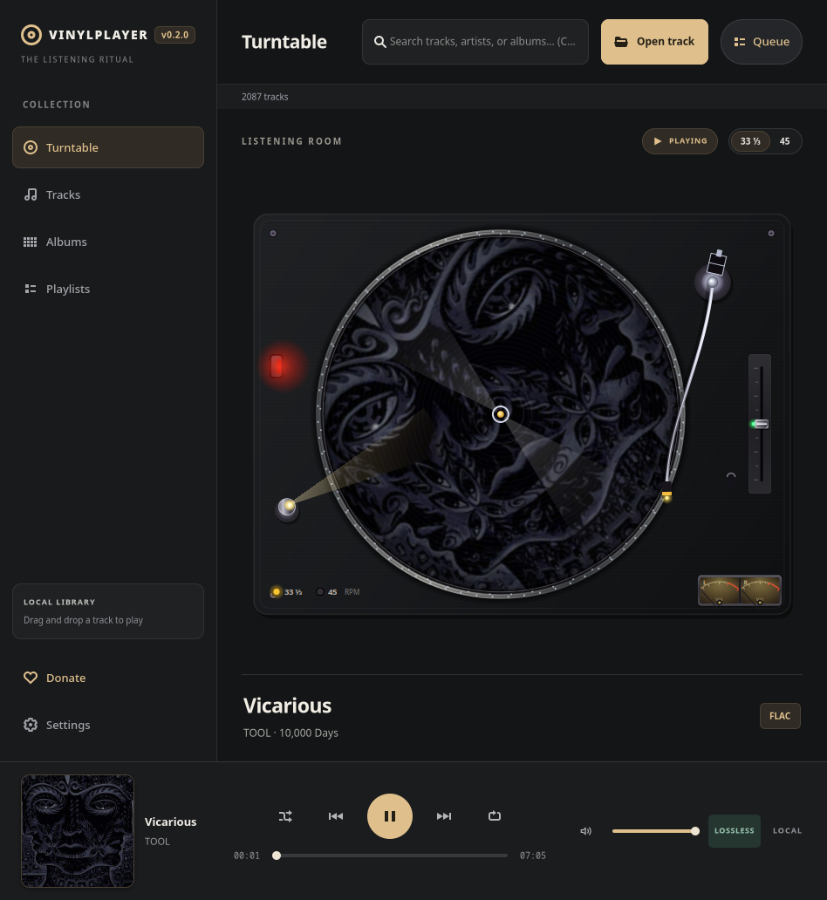
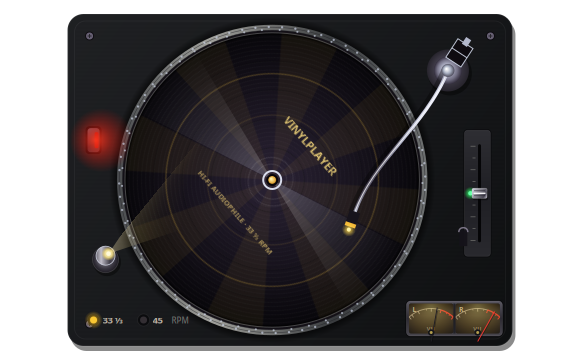
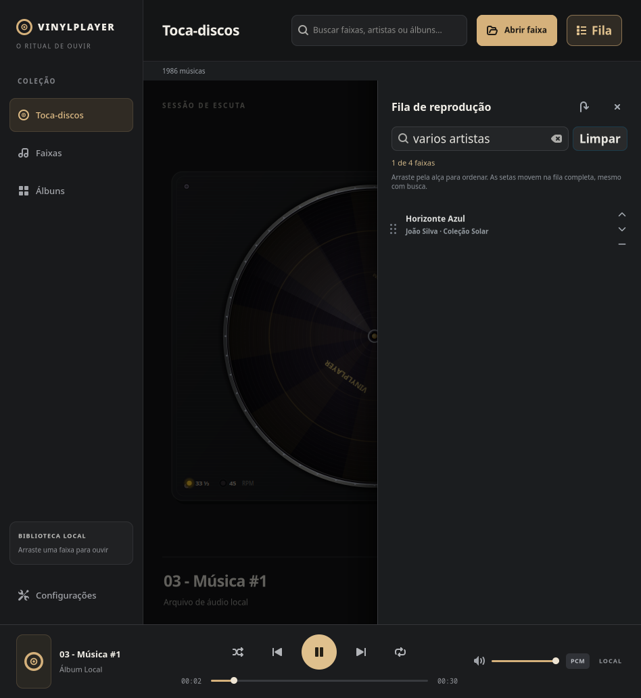

<div align="center">

# 🎵 VinylPlayer

**An analog-inspired, lightweight, and native music player for the Linux desktop (Wayland & X11).**

Crafted with **Rust**, **GTK4 / Libadwaita**, and **GStreamer / PipeWire**.

[](https://www.rust-lang.org/)
[](https://gtk.org/)
[](https://pipewire.org/)
[](LICENSE)
[](packaging/arch/PKGBUILD)

<br/>



</div>

---

## ✨ Highlights & Features

### 🎛️ Hi-Fi Analog Experience
- **Real-Time Cairo Turntable:** Vinyl platter and tonearm rendered in real-time with accurate angular physics and smooth vector rendering.
- **33 ⅓ & 45 RPM Speeds:** Dynamic speed selector toggle with authentic angular velocity (3.49 rad/s and 4.71 rad/s).
- **Technics SL-1200 Aesthetics:** Brushed graphite chassis, beveled tactile buttons, rim stroboscope, and target light illuminating the record groove.
- **Dynamic Center Label:** Rotating album cover artwork with typographic speed & track inscriptions.
- **Smooth Needle Drop:** Authentic vinyl drop acoustic effect at track start.
- **Analog Stereo VU Meters:** Vintage backlit meters featuring true physical ballistics (300ms attack time and natural exponential decay).
- **Floating Volume HUD:** Audiophile-grade circular volume gauge activated on scroll or keyboard shortcuts.

<div align="center">
  
  
</div>

---

### ⚡ Low-Latency Audio Engine
- **GStreamer (`playbin3`)** pipeline streaming directly to **PipeWire** for near-zero latency and bit-perfect playback.
- Native support for lossless and popular audio formats: **FLAC**, **WAV**, **OGG**, **MP3**, **M4A**, **OPUS**, **AAC**.
- Interactive seekbar with elapsed/total time display and instant scrubbing.
- Full support for Hi-Res audio (24-bit / 96kHz+).

---

### 📂 Smart Library & Playlists
- **Album & Track Browsing:** Responsive cover grid with high-resolution artwork extracted from embedded audio tags (FLAC/ID3v2) or local folder images (`cover.jpg`, `folder.png`).
- **Native M3U8 Playlist Manager:**
  - Create, import, and export playlists adhering to the M3U/M3U8 standard.
  - Full support for `file://` URIs, percent-decoding, and Windows backslash paths (`\`).
  - Seamless track reordering with compact dedicated controls and quick removal.
  - Custom audiophile amber styling (`#dfc08d`) adhering to modern Libadwaita design patterns.
- **Playback Queue with Real-Time Search:**
  - Instant multi-keyword search across titles, artists, and albums (case- and accent-insensitive).
  - Drag-and-drop or button reordering preserving original queue indices.
  - Automatic session and queue state persistence across launches (`~/.config/vinylplayer/state.json`).

<div align="center">
  
  
</div>

---

### 🐧 Native Linux Desktop Integration
- **D-Bus MPRIS v2:** Complete media key integration (Play/Pause, Next, Previous, Stop) with GNOME/KDE notification centers and status bars (Waybar, Polybar).
- **Desktop Notifications:** Native `notify-send` alerts when tracks are enqueued or playlists exported.
- **Drag & Drop:** Drop audio files, folders, or `.m3u`/`.m3u8` playlists directly onto the player window for instant playback.
- **Modern Theme:** Adaptive interface built on **Libadwaita** with native dark mode support.

---

### 📻 Native Last.fm Scrobbler
- **Audioscrobbler 2.0 API:** Cryptographically signed (`MD5` parameter hashing) scrobbling and real-time *Now Playing* status.
- **Web Authentication Flow:** One-click OAuth-like token handshake opening the browser for seamless authorization.
- **Audioscrobbler Compliance:** Follows official submission guidelines (50% playback or 4 minutes threshold, minimum 30s duration).
- **Zero Audio Hiccup:** Threaded non-blocking HTTP dispatch without audio buffer underruns or GTK main loop freezes.
- **Custom Credentials Support:** Embedded open-ecosystem fallback credentials plus customizable API key & secret support.

---

## 🛠️ Installation & Building

### Dependencies (Arch Linux / Manjaro)

```bash
sudo pacman -S gtk4 libadwaita gstreamer gst-plugins-base gst-plugins-good gst-plugin-pipewire cargo
```

*Optional dependencies:*
- `ffmpeg`: Enhanced metadata reading and tag extraction via `ffprobe`.
- `flac`: Fast embedded cover extraction for FLAC files via `metaflac`.

---

### Building from Source

```bash
# Clone the repository
git clone https://github.com/dznass-cmd/VinylPlayer.git
cd VinylPlayer

# Run in development mode
cargo run

# Build optimized release binary
cargo build --release

# Install locally
install -Dm755 target/release/vinylplayer ~/.local/bin/vinylplayer
install -Dm644 vinylplayer.desktop ~/.local/share/applications/vinylplayer.desktop
install -Dm644 assets/vinylplayer.svg ~/.local/share/icons/hicolor/scalable/apps/vinylplayer.svg
```

---

### Arch Linux Package (PKGBUILD)

The project includes an official PKGBUILD under `packaging/arch`:

```bash
cd packaging/arch
makepkg -si
```

---

## 🧪 Automated Testing

VinylPlayer features a comprehensive test suite covering Cairo math, VU meter ballistics, tag decoding, M3U8 parsing, and atomic persistence:

```bash
cargo test
```

---

## 📜 Changelog

For a detailed changelog and technical release notes, see [`MODIFICACOES.md`](./MODIFICACOES.md).

---

## 📄 License

Distributed under the **GNU General Public License v3.0 or later (GPL-3.0-or-later)**. See [`LICENSE`](./LICENSE) for details.
