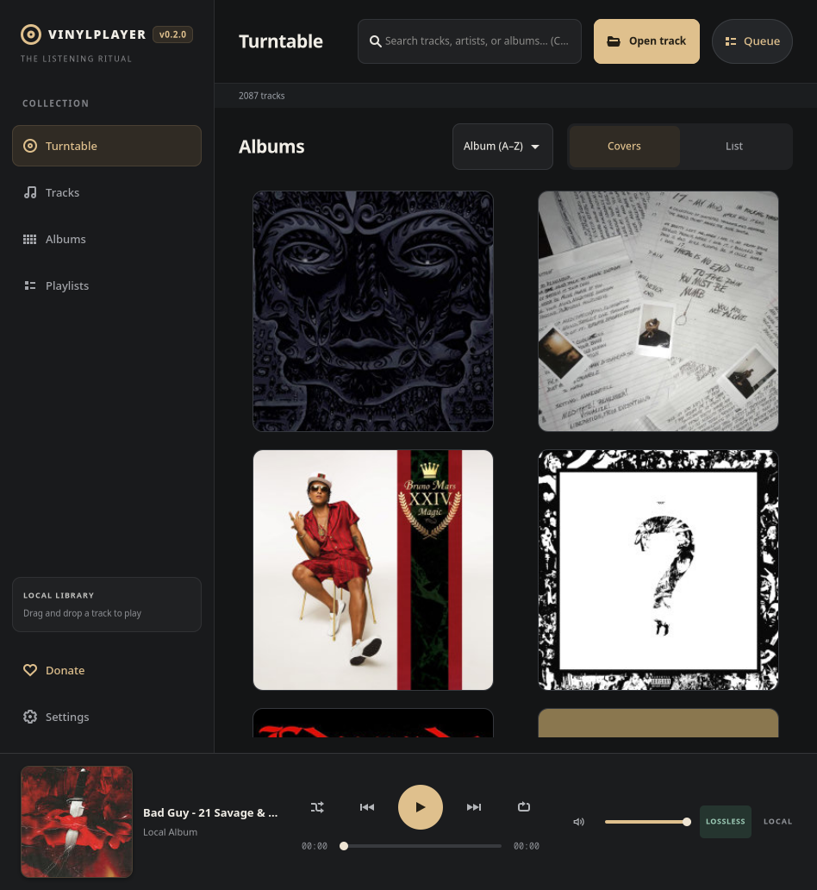
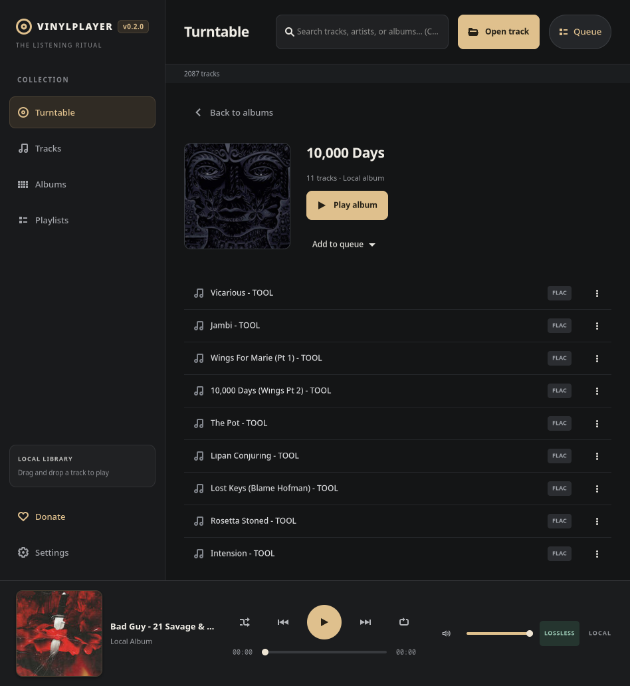
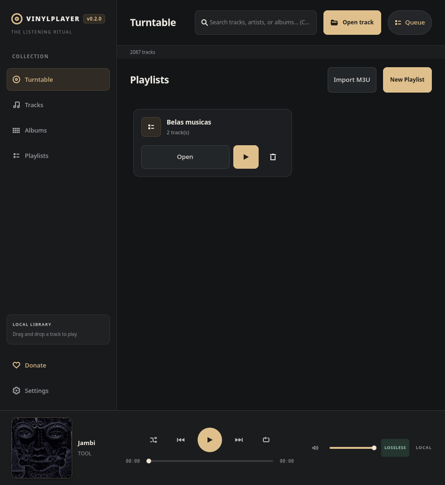
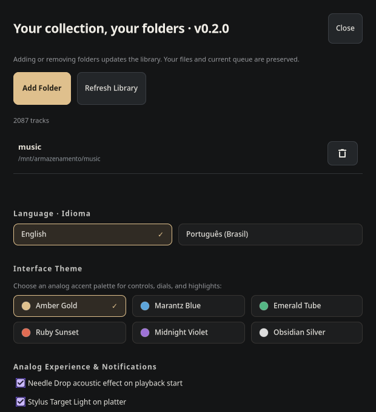
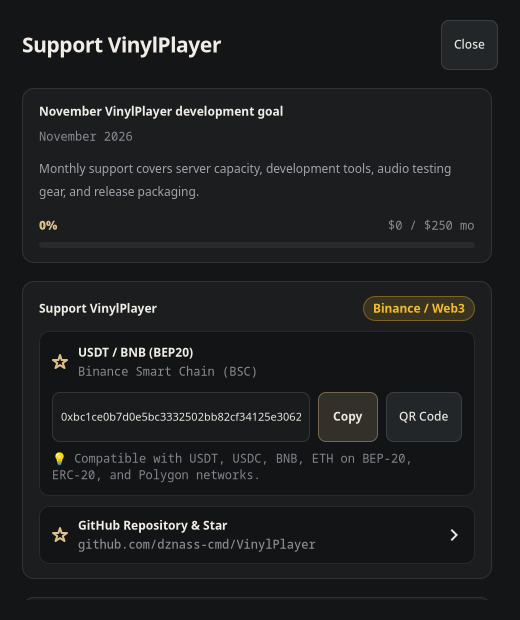

<div align="center">

# 🎵 VinylPlayer

**An analog-inspired, lightweight, and native music player for the Linux desktop (Wayland & X11).**

Crafted with **Rust**, **GTK4 / Libadwaita**, and **GStreamer / PipeWire**.

[](https://www.rust-lang.org/)
[](https://gtk.org/)
[](https://pipewire.org/)
[](Cargo.toml)
[](LICENSE)
[](packaging/arch/PKGBUILD)

<br/>


</div>

---

## ✨ Highlights & Features

### 🎛️ Hi-Fi Analog Experience
- **Real-Time Cairo Turntable:** Vinyl platter and precision tonearm rendered in real-time with accurate angular physics and smooth vector graphics (VSync-locked via `FrameClock`).
- **33 ⅓ & 45 RPM Speeds:** Dynamic speed selector toggle with authentic angular velocity (3.49 rad/s and 4.71 rad/s).
- **Technics SL-1200 Aesthetics:** Brushed graphite chassis, beveled tactile buttons, rim stroboscope, quartz lock indicator, and an incandescent target light illuminating the record groove.
- **Dynamic Center Label:** Rotating album cover artwork with typographic speed & track inscriptions.
- **Smooth Needle Drop:** Authentic procedural acoustic vinyl needle drop sound effect triggered seamlessly when starting playback.
- **Analog Stereo VU Meters:** Vintage backlit meters featuring true physical ballistics (300ms attack time and natural exponential decay).
- **Floating Volume HUD:** Audiophile-grade circular volume gauge activated on mouse scroll or keyboard shortcuts.
- **6 Analog Theme Palettes:** Amber Gold, Marantz Blue, Emerald Tube, Ruby Sunset, Midnight Violet, and Obsidian Silver.
- **Dual Language Support:** Full native localization in **English** and **Brazilian Portuguese**, with auto-detection and persistent preferences.

<div align="center">
  
  
</div>

---

### ⚡ Low-Latency Audio Engine
- **GStreamer (`playbin3`)** pipeline with native **PipeWire** output and automatic format negotiation.
- Native decoding for lossless and popular audio formats: **FLAC**, **WAV**, **OGG**, **MP3**, **M4A**, **OPUS**, **AAC**.
- Interactive seekbar with elapsed/total time display and instant scrubbing.
- Accepts Hi-Res sources (24-bit / 96kHz+); the final output format depends on GStreamer, PipeWire, and the selected audio device.
- Smooth volume adjustment via mouse scroll over the turntable platter and transport bar.

---

### 📂 Smart Library & Playlists
- **Album & Track Browsing:** Responsive cover grid and compact list view with high-resolution artwork extracted from embedded audio tags (FLAC/ID3v2) or local folder images (`cover.jpg`, `folder.png`).
- **On-Disk LRU Thumbnail Cache:** Automatically downscales covers to 256px JPEG, reducing memory consumption by over 63% on large libraries.
- **Native M3U8 Playlist Manager:**
  - Create, import, and export playlists adhering to the M3U/M3U8 standard.
  - Full support for `file://` URIs, percent-decoding, and Windows backslash paths (`\`).
  - Seamless track reordering with compact dedicated controls, unsaved change warnings, and quick removal.
- **Playback Queue with Real-Time Search:**
  - Instant multi-keyword search across titles, artists, and albums (case- and accent-insensitive).
  - Drag-and-drop or button reordering preserving original queue indices.
  - Automatic session and queue state persistence across launches (`~/.config/vinylplayer/state.json`).

<div align="center">
  
  
</div>

<div align="center">
  
  
</div>

---

### 📻 Native Last.fm Scrobbler
- **Audioscrobbler 2.0 API:** Cryptographically signed (`MD5` parameter hashing) scrobbling and real-time *Now Playing* status.
- **Web Authentication Flow:** One-click OAuth-like token handshake opening the browser for seamless authorization.
- **Audioscrobbler Compliance:** Follows official submission guidelines ($\ge \min(\text{duration} / 2, 240\text{s})$ on tracks $\ge 30\text{s}$).
- **Zero Audio Hiccup:** Threaded non-blocking HTTP dispatch without audio buffer underruns or GTK main loop freezes.
- **Bring-Your-Own Credentials:** Configure a Last.fm API key and shared secret in Settings; the repository does not embed credentials.
- **Secure Credential Storage:** Last.fm keys and sessions use Secret Service on the desktop and the encrypted Secret portal inside Flatpak. If neither is available, VinylPlayer falls back to its mode-0600 preferences file without blocking the interface.

To enable scrobbling, create an API account at [Last.fm](https://www.last.fm/api/account/create), then enter its API key and shared secret under **Settings → Last.fm**. Existing plaintext credentials are migrated out of `state.json` automatically when the desktop secret store is available.

<div align="center">
  
  
</div>

---

### 🐧 Native Linux Desktop Integration
- **D-Bus MPRIS v2:** Complete media key integration (Play/Pause, Next, Previous, Stop) with GNOME/KDE notification centers and status bars (Waybar, Polybar).
- **Desktop Notifications:** Native `notify-send` alerts when tracks are enqueued or playlists exported.
- **Drag & Drop:** Drop audio files, folders, or `.m3u`/`.m3u8` playlists directly onto the player window for instant playback.
- **Modern Theme:** Adaptive interface built on **Libadwaita** with native dark mode support.

---

## ⌨️ Keyboard & Mouse Shortcuts

| Key / Action | Action Description |
|:---|:---|
| <kbd>Space</kbd> / <kbd>k</kbd> | Toggle Play / Pause |
| <kbd>j</kbd> / <kbd>Left</kbd> | Seek backward 5 seconds |
| <kbd>Shift</kbd> + <kbd>Left</kbd> | Seek backward 10 seconds |
| <kbd>l</kbd> / <kbd>Right</kbd> | Seek forward 5 seconds |
| <kbd>Shift</kbd> + <kbd>Right</kbd> | Seek forward 10 seconds |
| <kbd>Page Down</kbd> / <kbd>n</kbd> | Next track |
| <kbd>Page Up</kbd> / <kbd>p</kbd> | Previous track |
| <kbd>Home</kbd> | Seek to beginning of track (0:00) |
| <kbd>m</kbd> | Mute / Unmute audio |
| <kbd>Alt</kbd> + <kbd>1</kbd> | Switch to Overview (Turntable) view |
| <kbd>Alt</kbd> + <kbd>2</kbd> | Switch to Albums collection view |
| <kbd>Alt</kbd> + <kbd>3</kbd> | Switch to Playlists view |
| <kbd>Ctrl</kbd> + <kbd>j</kbd> | Toggle Playback Queue side panel |
| <kbd>Ctrl</kbd> + <kbd>f</kbd> | Focus Playback Queue search field |
| <kbd>Ctrl</kbd> + <kbd>o</kbd> | Open single audio track file dialog |
| <kbd>Ctrl</kbd> + <kbd>,</kbd> | Open Settings (Library, Themes, Last.fm, Language) |
| <kbd>Ctrl</kbd> + <kbd>Shift</kbd> + <kbd>d</kbd> | Open Support & Donation dialog |
| <kbd>Mouse Scroll</kbd> (Turntable / Transport) | Smooth volume control with floating circular HUD |

---

## 🛠️ Installation & Building

### Dependencies (Arch Linux / Manjaro)

```bash
sudo pacman -S gtk4 libadwaita gstreamer gst-plugins-base gst-plugins-good gst-plugin-pipewire cargo
```

*Optional dependencies:*
- `ffmpeg`: Enhanced metadata reading and tag extraction via `ffprobe`.
- `flac`: Fast embedded cover extraction for FLAC files via `metaflac`.

### Dependencies (Ubuntu / Debian)

```bash
sudo apt install libgtk-4-dev libadwaita-1-dev libgstreamer1.0-dev \
  libgstreamer-plugins-base1.0-dev gstreamer1.0-plugins-base \
  gstreamer1.0-plugins-good gstreamer1.0-pipewire cargo
```

### Dependencies (Fedora)

```bash
sudo dnf install gtk4-devel libadwaita-devel gstreamer1-devel \
  gstreamer1-plugins-base-devel gstreamer1-plugins-good \
  gstreamer1-plugin-pipewire cargo
```

---

### Building from Source

```bash
# Clone the repository
git clone https://github.com/dznass-cmd/VinylPlayer.git
cd VinylPlayer

# Run in development mode
cargo run

# Build optimized release binary
cargo build --release

# Install locally
install -Dm755 target/release/vinylplayer ~/.local/bin/vinylplayer
install -Dm644 vinylplayer.desktop ~/.local/share/applications/io.github.vinylplayer.desktop
install -Dm644 assets/vinylplayer.svg ~/.local/share/icons/hicolor/scalable/apps/io.github.vinylplayer.svg
install -Dm644 assets/vinylplayer.svg ~/.local/share/icons/hicolor/scalable/apps/vinylplayer.svg
install -Dm644 io.github.vinylplayer.metainfo.xml ~/.local/share/metainfo/io.github.vinylplayer.metainfo.xml
```

---

### Arch Linux Package (PKGBUILD)

The project includes an official PKGBUILD under `packaging/arch`:

```bash
cd packaging/arch
makepkg -si
```

### Flatpak Bundle

Each GitHub release includes a self-contained `VinylPlayer.flatpak` bundle:

```bash
flatpak install --user ./VinylPlayer.flatpak
flatpak run io.github.vinylplayer
```

---

## 🧪 Automated Testing

VinylPlayer features an extensive automated test suite covering Cairo rendering math, VU meter ballistics, tag decoding, M3U8 parsing, and atomic state persistence:

```bash
cargo fmt --check
cargo clippy --all-targets -- -D warnings
cargo test
```

GitHub Actions also runs the ignored GTK/media integration suite under Xvfb, records cold-start time and peak resident memory, and builds the Flatpak and Arch artifacts for version tags.

See [`CONTRIBUTING.md`](./CONTRIBUTING.md) for the development workflow and [`SECURITY.md`](./SECURITY.md) for responsible vulnerability reporting.

---

## 📜 Changelog

For a detailed changelog and technical release notes, see [`MODIFICACOES.md`](./MODIFICACOES.md).

---

## 📄 License

Distributed under the **GNU General Public License v3.0 or later (GPL-3.0-or-later)**. See [`LICENSE`](./LICENSE) for details.
