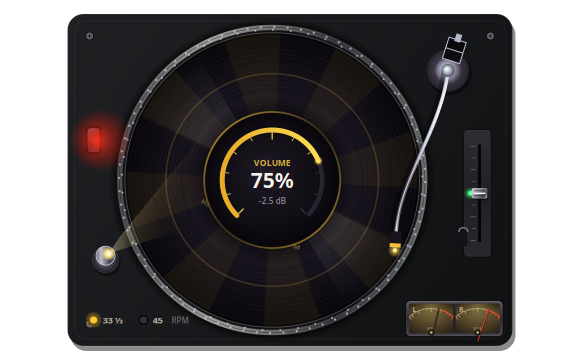
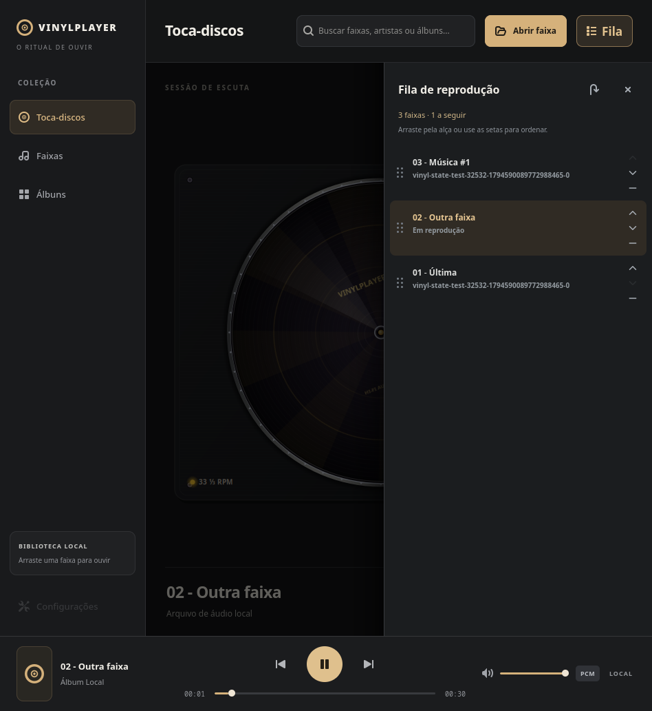

<div align="center">

# 🎵 VinylPlayer

**Player de música analógico, nativo, ultraleve e integrado ao desktop Linux (Wayland & X11).**

Construído com **Rust**, **GTK4 / Libadwaita** e **GStreamer / PipeWire**.

[](https://www.rust-lang.org/)
[](https://gtk.org/)
[](https://pipewire.org/)
[](LICENSE)
[](packaging/arch/PKGBUILD)

<br/>


</div>

---

## ✨ Destaques & Funcionalidades

### 🎛️ Experiência Analógica Hi-Fi
- **Toca-Discos Animado em Cairo:** Prato de vinil e braço de leitura desenhados com física vetorial contínua em tempo real.
- **Velocidades 33 ⅓ e 45 RPM:** Chave seletora com alternância angular dinâmica (3.49 rad/s e 4.71 rad/s).
- **Design Technics SL-1200:** Deck em grafite escovado, botões táteis chanfrados, estroboscópio e luz de mira (*Target Light*) iluminando o sulco do disco.
- **Selo Central Dinâmico:** Arte do álbum em rotação com inscrição tipográfica personalizada.
- **Needle Drop Suave:** Efeito analógico autêntico de queda da agulha no início da reprodução.
- **Medidores VU Estéreo Analógicos:** Indicadores vintage retroiluminados com balística física real (tempo de ataque de 300ms e retorno de decaimento natural).
- **Volume HUD Gauge:** Mostrador circular flutuante estilo audiófilo acionado por scroll ou atalhos.

<div align="center">
  
  
</div>

---

### ⚡ Motor de Áudio de Baixa Latência
- Pipeline **GStreamer (`playbin3`)** com saída direta em **PipeWire** para latência imperceptível e fidelidade bit-perfect.
- Suporte nativo a formatos de alta fidelidade: **FLAC**, **WAV**, **OGG**, **MP3**, **M4A**, **OPUS**, **AAC**.
- Seekbar interativa com indicador de tempo decorrido/total e scrubbing instantâneo.
- Suporte a áudio Hi-Res (24-bit / 96kHz+).

---

### 📂 Biblioteca Inteligente & Playlists
- **Visualização por Álbuns e Músicas:** Grade responsiva com capas de álbuns em alta resolução extraídas diretamente das tags embutidas (FLAC/ID3v2) ou arquivos locais (`cover.jpg`, `folder.png`).
- **Gerenciador de Playlists M3U8:**
  - Criação, importação e exportação de listas no padrão M3U/M3U8.
  - Suporte completo a URIs `file://`, percent-decoding e compatibilidade com caminhos Windows (`\`).
  - Reordenação de faixas com botões compactos dedicados e remoção rápida.
  - Cartões com visual vintage âmbar (`#dfc08d`) e detalhes integrados ao tema do sistema.
- **Fila de Reprodução com Busca em Tempo Real:**
  - Pesquisa instantânea por título, artista e álbum na fila, insensível a acentos e maiúsculas.
  - Reordenação e remoção preservando os índices reais de execução.
  - Persistência automática da fila e da sessão entre reinicializações do player (`~/.config/vinylplayer/state.json`).

<div align="center">
  
  
</div>

---

### 🐧 Integração Nativa com o Desktop Linux
- **D-Bus MPRIS v2:** Controle total de mídia através das teclas de atalho do teclado, centrais de notificações (GNOME / KDE) e widgets de barra (Waybar / Polybar).
- **Notificações de Sistema:** Feedback nativo com `notify-send` ao adicionar faixas, atualizar listas ou exportar playlists.
- **Drag-and-Drop:** Arraste pastas, músicas ou arquivos `.m3u`/`.m3u8` diretamente para a janela do aplicativo para tocar na hora.
- **Design Moderno:** Interface adaptativa com **Libadwaita** e suporte nativo ao Dark Mode do ecossistema GNOME/Wayland.

---

## 🛠️ Instalação e Compilação

### Dependências (Arch Linux / Manjaro)

```bash
sudo pacman -S gtk4 libadwaita gstreamer gst-plugins-base gst-plugins-good gst-plugin-pipewire cargo
```

*Dependências opcionais:*
- `ffmpeg`: Leitura aprofundada de metadados e tags avançadas com `ffprobe`.
- `flac`: Extração veloz de capas embutidas em arquivos FLAC com `metaflac`.

---

### Compilar a partir do código-fonte

```bash
# Clonar o repositório
git clone https://github.com/dznass-cmd/VinylPlayer.git
cd VinylPlayer

# Executar em modo desenvolvimento
cargo run

# Compilar binário otimizado para produção
cargo build --release

# Instalar o executável no ambiente local
install -Dm755 target/release/vinylplayer ~/.local/bin/vinylplayer
install -Dm644 vinylplayer.desktop ~/.local/share/applications/vinylplayer.desktop
install -Dm644 assets/vinylplayer.svg ~/.local/share/icons/hicolor/scalable/apps/vinylplayer.svg
```

---

### Pacote Arch Linux (PKGBUILD)

O projeto inclui receita oficial de empacotamento:

```bash
cd packaging/arch
makepkg -si
```

---

## 🧪 Testes Automatizados

O VinylPlayer conta com uma suíte abrangente de testes unitários e de integração cobrindo matemática do toca-discos, balística do VU meter, decodificação de tags, parsing de playlists M3U8 e persistência atômica:

```bash
cargo test
```

---

## 📜 Histórico de Modificações

Para uma visão detalhada da evolução técnica, consulte o arquivo [`MODIFICACOES.md`](./MODIFICACOES.md).

---

## 📄 Licença

Distribuído sob a licença **GNU General Public License v3.0 or later (GPL-3.0-or-later)**. Consulte o arquivo [`LICENSE`](./LICENSE) para mais informações.
